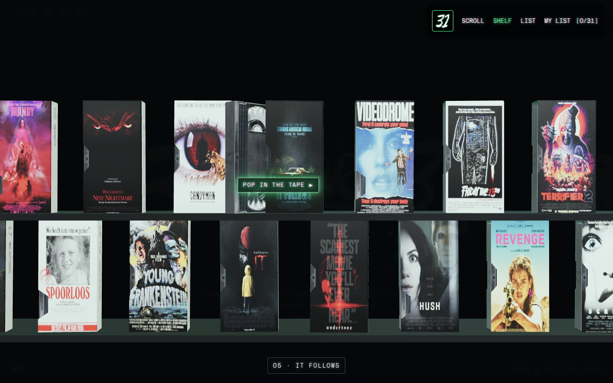
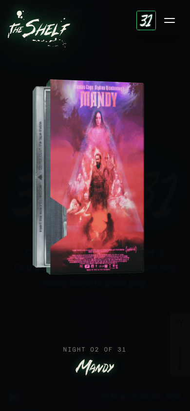

# 31 for 31

[31-for-31.com](https://www.31-for-31.com/) deneyiminin Next.js ile hazırlanmış konsept rekreasyonu. Özgün tasarım ve içerik Meredith McGrade'a aittir; kaynak sitedeki tasarım kredileri uygulamada korunmuştur.



## Deneyim

- 31 film, özgün metinler, afişler, fontlar ve üç bölüm arası geçiş.
- GSAP ScrollTrigger ve Lenis ile dikey/yatay scroll, sabitlenen sahneler, bulanıklık ve tipografi animasyonları.
- Three.js ile hareketli el, hayalet, kaset rafı ve VHS oynatıcı; yerel Draco çözümleyici ve yedi GLB model.
- Masaüstünde sürüklenen raf; mobilde kaydırılan kasetler; klavye ile seçim.
- VHS açılışı, sis, tarama çizgileri, özel imleç, Lottie grafikleri ve isteğe bağlı sesler.
- Sıralama/filtreleme, izleme takibi, kişisel film değiştirme, oylar, liste senkronizasyonu, PNG kaset etiketi ve bonus kaset.



## Çalıştırma

Node.js **22.13 veya üzeri** gerekir.

```sh
npm ci
npm run dev
```

Geliştirme adresi: [localhost:3000](http://localhost:3000).

```sh
npm run build
npm start
```

## Yapı

| Konum | İşlev |
| --- | --- |
| `app/` | Next.js App Router, metadata ve HTTP uçları |
| `components/` | Sunucuda render edilen film bölümleri, sahneler ve görünümler |
| `components/TapeRuntime.jsx` | Animasyon ve etkileşim katmanının bir kez başlatılması |
| `lib/films.js` | 31 film ve bonus film verisi |
| `lib/store.js` | SQLite bağlantısı |
| `public/js/` | Scroll, ses, WebGL, kişisel liste ve paylaşım davranışları |
| `public/assets/` | Afişler, fontlar, modeller, sesler ve görseller |
| `public/vendor/` | GSAP, ScrollTrigger, Lenis, Lottie, Three.js ve Draco |

## Kayıt ve senkronizasyon

İzleme listesi tarayıcıda saklanır. `/api/lists/[id]` anonim bağlantı/kod ile cihazlar arası senkronizasyon sağlar. Oylar `/api/ratings/[slug]` üzerinden bu kurulumun veritabanına kaydedilir.

Veritabanı varsayılan olarak Git'e alınmayan `.tape-data/tape.sqlite` dosyasındadır. Kalıcı sunucuda bu klasörün yazılabilir ve kalıcı olması gerekir. Başka bir veri konumu için `TAPE_DATA_DIR` ortam değişkenini ayarlayın. Çoklu sunucu veya geçici dosya sistemli dağıtımlarda ortak bir veritabanı uyarlaması gerekir.

Görsel varlıklar ve animasyon kütüphaneleri yerelden sunulur. “Where to watch” bağlantıları JustWatch'ı açar.

## Doğrulama

- `npm run build` başarılı.
- 31 film bölümündeki 2.937 normalize DOM kaydı kaynakla eşleşti.
- Masaüstü ve 390 × 844 mobil görünümde başlık, ilk film, film şeridi ve kapanış sahnelerinin konum/ölçüleri referansla karşılaştırıldı; ölçülen değerler eşleşti.
- Raf sürükleme/kaydırma, klavye seçimi, film açma, liste takibi, film değiştirme/geri yükleme ve PNG paylaşım üretimi kontrol edildi.
- Oy tekrarlarının tekilleştirilmesi, liste kaydı, veri doğrulama ve eski kayıtların daha yeni veriyi ezmemesi kontrol edildi.

Özgün CSS ve görsel davranışlar korunarak içerik gerçek React bileşenlerine taşınmıştır. Kaynak sitenin oy servisi yerine bu projeye ait yerel API kullanılır.
